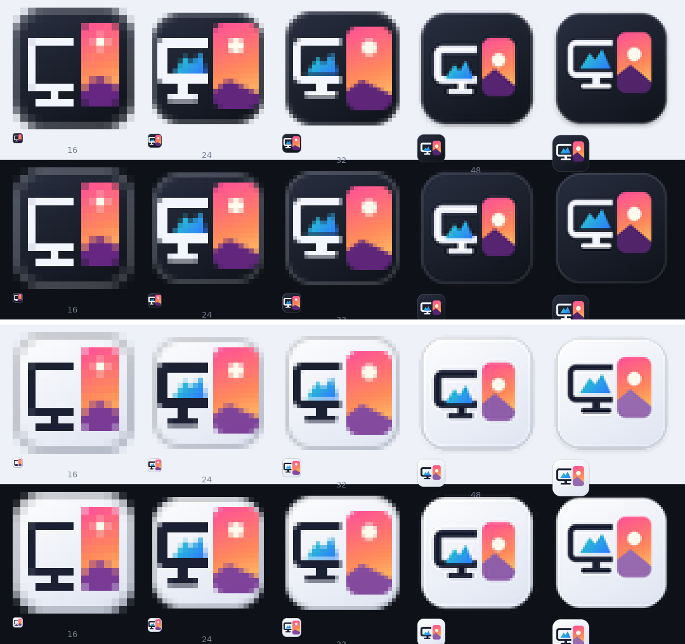

# Wallpaper Switcher

A very small, dependency-free Windows tray app that rotates your desktop wallpaper from a
folder, with proper multi-monitor support. Native C++17 and the Win32 API only - one ~600 KB
executable, no runtime, no installer, nothing running except a tray icon.

<p align="center"></p>

## Features

- **Tray-only**: left-click = next wallpaper, right-click = menu, `Ctrl+Alt+Right` / `Ctrl+Alt+Left` = next / previous.
- **Multi-monitor**: the same image on every monitor, or a different image on each (with a per-monitor "Next"),
  or one picture spanning all of them. Two displays never show the same image.
- **Orientation matching**: landscape displays get landscape pictures. Orientation comes from the EXIF
  Orientation tag when present, otherwise from the pixel size.
- **Smart crop for portrait monitors**: a landscape picture on a portrait display is cropped by the app, not by
  Windows' centre-crop. The crop keeps the full image height and slides to the most detailed / highest-contrast
  region, pulled towards face regions saved in the file's XMP (Windows people tags, MWG regions). Crops are
  cached as PNGs.
- **Cross-fade** (500 ms, smoothstep easing, vblank-paced) between wallpapers, drawn behind the desktop icons.
- **Fast on huge folders**: opening a folder only lists file names. Images are inspected lazily - a handful per
  switch, a few random ones whenever the menu opens - and remembered for the session.
- Fill / Fit / Stretch / Center / Tile / Span, shuffle or sorted, 1 minute - 3 hours or manual, run at startup.
- Selectable tray icon (dark, light, or follow the Windows theme).

## Requirements

Windows 10 or 11 (64-bit). Windows 8 / 8.1 should work (the app uses `IDesktopWallpaper`, introduced in
Windows 8) but is not tested there.

## Build

Prerequisites: CMake 3.20+ and either Visual Studio 2022 (MSVC) or MinGW-w64 (GCC 11+).

```powershell
# Visual Studio (from a Developer PowerShell)
cmake -S . -B build -A x64
cmake --build build --config Release
ctest --test-dir build -C Release          # unit tests
# -> build\Release\WallpaperSwitcher.exe
```

```bash
# MinGW-w64 cross build from Linux / macOS (no tests: they would be Windows binaries)
cmake -S . -B build-mingw -DCMAKE_TOOLCHAIN_FILE=cmake/mingw-w64-x86_64.cmake -DWS_BUILD_TESTS=OFF
cmake --build build-mingw
# -> build-mingw/WallpaperSwitcher.exe

# Portable unit tests only (any OS)
cmake -S . -B build-tests -DWS_BUILD_APP=OFF
cmake --build build-tests && ctest --test-dir build-tests --output-on-failure
```

Options: `-DWS_BUILD_APP=OFF` (tests only), `-DWS_BUILD_TESTS=OFF`.

## Using it

On first start you are asked for a picture folder (`.jpg`, `.jpeg`, `.png`, `.bmp`; subfolders are not scanned).
Everything else is in the tray menu:

| Menu item | What it does |
|---|---|
| Next / Previous wallpaper | Also `Ctrl+Alt+Right` / `Ctrl+Alt+Left` |
| Choose folder... / Rescan folder | Pick the folder / pick up added and removed files |
| Change every | Manual, 1, 5, 15, 30 minutes, 1 or 3 hours |
| Picture position | Fill, Fit, Stretch, Center, Tile, Span across monitors |
| Monitors | Same / different image per monitor, smart crop on portrait monitors, "Next on monitor N", image counts |
| Icon | Dark, Light, or match the Windows theme |
| Shuffle, Cross-fade transition, Run at startup | Toggles |

Settings live in `HKCU\Software\WallpaperSwitcher`. Cropped pictures are cached in
`%LOCALAPPDATA%\WallpaperSwitcher\crops` (64 most recent kept). Diagnostics go to the debugger output
(`OutputDebugString`; view with DebugView).

## Project layout

```
src/core/       portable logic, no Windows types: playlist & selection, crop maths, fade maths
src/            Win32 / COM layer: app (tray, menu), desktop (IDesktopWallpaper), fade, wic, smart_crop,
                image_library, config, win_util (RAII + checked-call helpers)
resources/      manifest, .rc, icons (dark & light, 16-256 px)
tests/          unit tests for src/core (built and run by CTest on any OS)
tools/icons/    Python scripts that generate the icons (Pillow + NumPy)
docs/           ARCHITECTURE.md, CODE_REVIEW.md
```

See [docs/ARCHITECTURE.md](docs/ARCHITECTURE.md) for how the pieces fit together.

## Known limitations

- The cross-fade relies on Explorer's desktop window layout (the "WorkerW" behind the icons). If the layout is not
  recognised, wallpapers change instantly. Turn it off from the menu if it misbehaves.
- Image work (classification, cropping, the fade) runs on the UI thread, so the tray menu is briefly unresponsive
  during a switch - see the roadmap.
- EXIF rotation is applied when classifying and cropping; if Windows itself ignores the tag for a picture it will
  be drawn sideways by Windows.
- Face regions are only read from file metadata; the app does not detect faces by itself.

## Roadmap

- Move classification / cropping to a worker thread with completion messages (see `docs/CODE_REVIEW.md`, WS-006).
- Persist the orientation cache between sessions.
- Optional subfolder scanning.

## License

MIT - see [LICENSE](LICENSE).
